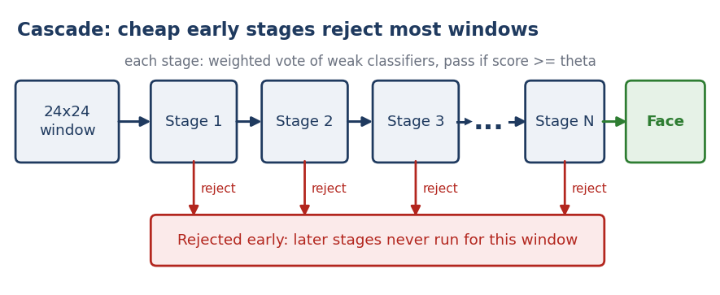
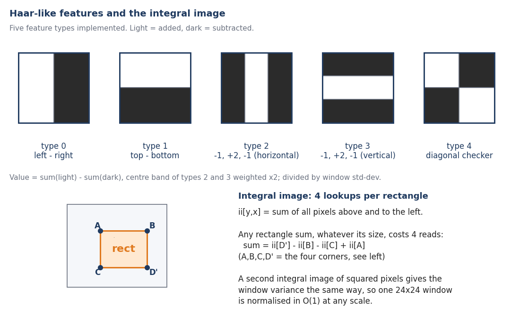
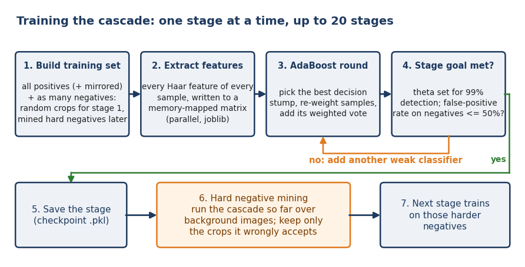

# Viola-Jones Face Detector from Scratch

<div align="center">


</div>

A face detector built without any pretrained model: integral images, Haar-like features, AdaBoost and a rejection cascade, all written by hand. It trains on hard negatives mined from large background images and detects faces on images, folders or a live webcam stream with a Numba-compiled multi-scale scanner.

**At a glance**

- **Problem:** detect faces in images and live video with no pretrained detector.
- **Approach:** Haar-like features from integral images, AdaBoost stumps, a cascade of up to 20 stages trained with hard negative mining.
- **Engineering:** memory-mapped feature matrix, parallel extraction, resumable checkpoints, Numba-parallel multi-scale inference with NMS.
- **Stack:** Python 3.12, NumPy, Numba, OpenCV (I/O and drawing), scikit-learn (metrics), joblib.

<div align="center">

<br><sub>A window is accepted only if it passes every stage; most are rejected by the first few.</sub>
</div>

OpenCV's Haar cascade is used only as a baseline in `notebooks/analysis.ipynb`. Both the Viola-Jones pipeline and its detector are written by hand; no pretrained model is used.

## Why from scratch

The goal was to understand and rebuild every piece of the classic 2001 pipeline rather than call `cv2.CascadeClassifier`. The parts that took real engineering:

- **Constant-time features.** Every rectangle sum is 4 reads from an integral image; a second integral image of squared pixels gives per-window variance, so features are contrast-normalised at any scale.
- **Training that fits in memory.** The feature matrix (all Haar features of every sample) lives in a memory-mapped file and is filled in parallel with `joblib`. Progress is checkpointed every few weak classifiers and after every stage, so long runs can be resumed.
- **Hard negative mining.** After each stage, background images are scanned with the cascade built so far and only the crops it wrongly accepts become the next stage's negatives.
- **Fast inference.** The cascade is flattened into plain NumPy arrays and evaluated by a `@njit(parallel=True)` kernel that stops evaluating a window as soon as one stage rejects it.

## How it works

<div align="center">
<br><sub>Haar feature types implemented, and the integral-image rectangle sum.</sub>
</div>

Windows are 24x24 grayscale. The five feature types above are enumerated at every valid position and size (`generate_features`) and evaluated from the integral image (`compute_feature`).

<div align="center">
<br><sub>One stage of training, repeated until the cascade is complete.</sub>
</div>

Each stage is boosted until it reaches the target detection rate and false-positive rate (defaults in `viola_jones/train.py`: up to 20 stages, 0.99 detection and 0.50 false-positive rate per stage). Training positives are mirrored and get random rotation or shear while features are extracted. At detection time, windows are searched at multiple scales, survivors of the last stage are merged with non-maximum suppression, and results are drawn on the image or camera frame.

## Repository layout

```
viola_jones/
  train.py        cascade training and evaluation
  inference.py    Numba inference: images, folders, webcam
data_prep/        dataset construction scripts (faces, backgrounds)
notebooks/
  analysis.ipynb  feature diagnostics, comparison with OpenCV Haar
assets/           diagrams used in this README
requirements.txt
```

## Setup

```bash
python3.12 -m venv venv && source venv/bin/activate
pip install -r requirements.txt
```

`requirements.txt` also lists packages used only by `data_prep/` (YOLO filtering, dataset download).

## Data

Training uses 24x24 grayscale crops. No dataset or trained cascade is included in the repository, so you need to build the data and train before running detection.

1. Put source face images in `face_images/` and run `python data_prep/prepare_faces.py`. It crops faces with a margin and splits train/test into `dataset/faces_clean` and `dataset/faces_test`.
2. Build the background set with the numbered scripts in `data_prep/` (download, deduplicate, filter people out with YOLO, crop). Expected folders: `dataset/background_clean` (large training backgrounds for mining) and `dataset/background_crops` (test negatives).

The `data_prep/` scripts were converted mechanically from notebooks and have not been re-run since, so expect to adjust paths.

## Train

```bash
python viola_jones/train.py
```

Paths and hyperparameters are set at the bottom of `train.py`. Each finished stage is saved as `checkpoints/stage_NN_complete.pkl` and the full cascade as `checkpoints/cascade_final.pkl`. After training, precision, recall, false-positive rate and F1 on the held-out test set are printed. Re-running resumes from the last checkpoint.

## Detect

```bash
# webcam
python viola_jones/inference.py --stages checkpoints --num 20

# one image (writes <name>_detected.jpg and opens a window)
python viola_jones/inference.py --stages checkpoints --num 20 \
    --images path/to/photo.jpg
```

`--stages` is the folder holding the `stage_NN_complete.pkl` files and `--num` is how many stages to load (use fewer to see the effect of a shorter cascade). Other flags: `--scale` and `--step` (multi-scale search), `--min-size`, `--nms-thresh`, `--detect-every` and `--detect-scale` (speed up camera mode), `--threads`.
